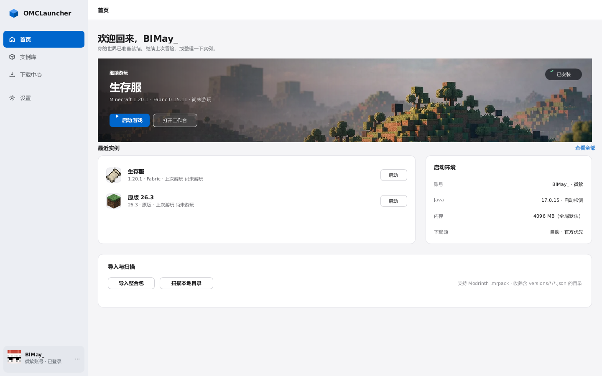
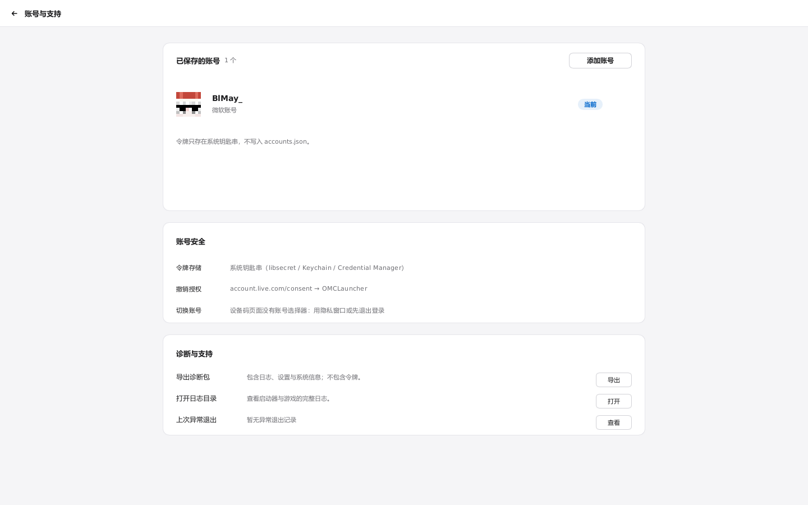

# OMCLauncher

An open-source third-party launcher for **Minecraft: Java Edition**, written in Rust with a
native Slint UI — no Electron, no bundled Java runtime, a single ~20 MiB binary on Linux.

> Non-official project, not affiliated with Mojang Studios or Microsoft.
> Licensed under **GPL-3.0-only**.





## Features

| Area | What it does |
|---|---|
| Accounts | Microsoft device-code sign-in (public client, `XboxLive.signin offline_access`), game-ownership check via `/entitlements/mcstore`, tokens in the OS keychain; offline accounts |
| Versions | Vanilla plus Fabric / Quilt / Forge / NeoForge; Forge-family installers run locally against the official processor metadata |
| Instances | Isolated game directories, per-instance settings, loader switching without re-downloading the game, custom icons, mod enable/disable and removal |
| Downloads | Concurrent queue with resume, SHA-1 verification, content-addressed cache, official/BMCLAPI source switching, HTTP proxy support |
| Resources | Modrinth and CurseForge search for mods, modpacks, resource packs and shaders; filters for game version, loader and environment; page-numbered results and version tables; install into an instance or save elsewhere; update checks against an installed index |
| Diagnostics | File logs with rotation, crash detection with cause hints, one-click diagnostic bundle (logs, settings, system info — no tokens) |
| Packaging | Debian package and portable tarball, covered by a smoke test |

## Build

Requires Rust 1.92 (see `rust-toolchain.toml`). On Linux you also need the usual X11/Wayland
development libraries (libxkbcommon, fontconfig) for the windowing backend.

```bash
cargo build --release -p mcl-app
./target/release/mcl-app
```

Microsoft sign-in needs an Azure app registration (public client, no secret). Inject its
client ID at build time; without it the launcher still runs with offline accounts:

```bash
MCL_MSA_CLIENT_ID=<your-client-id> cargo build --release -p mcl-app
```

## Project layout

| Crate | Role |
|---|---|
| `mcl-core` | Domain and services: versions, loaders, downloads, accounts, resources |
| `mcl-app-model` | UI-agnostic view models and task orchestration; no GUI framework dependency |
| `mcl-app` | Slint shell: windows, pages, components |
| `mcl-cli` | Scriptable entry point used by CI smoke tests |

The dependency direction is `mcl-app` → `mcl-app-model` → `mcl-core`; CI enforces that
`mcl-app-model` and `mcl-core` never depend on Slint.

## Checks

```bash
cargo fmt --all -- --check
cargo clippy --workspace --all-targets -- -D warnings
cargo test --workspace
```

## License

GPL-3.0-only. Bundled instance icons come from HMCL (GPL-3.0-or-later); see
`crates/mcl-app-model/assets/icons/NOTICE.md`.
